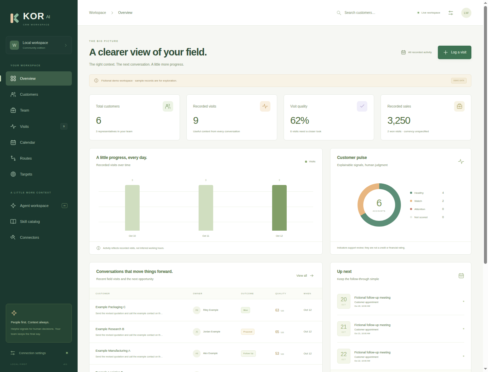
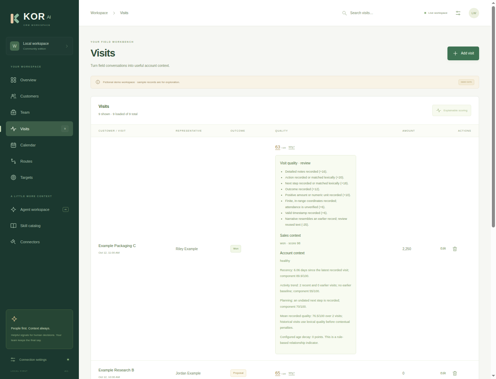

# Fictional demonstration

All records, names, addresses, coordinates, notes and amounts in this directory's
screenshots and the `examples` directory were created for this public release.
The example.test domains are intentionally reserved example addresses. No real
business, contact or recorded visit is represented. Amounts have no assigned
currency.

The fixed demonstration timeline is October 2026; it does not shift when you run
the application. An appointment becomes historical as real time advances. The
exported example analysis uses the explicit reference date
`2026-10-18T12:00:00.000Z`, so its results remain reproducible.

- [Fictional records](../examples/fictional-records.json)
- [Explainable visit and customer analysis](../examples/analysis.json)
- [Dashboard summary](../examples/summary.json)
- [SHA-256 fingerprints](../examples/manifest.json)

Regenerate these files with `node scripts/generate-examples.js`. The exporter only
creates a new in-memory demo; it never opens or exports a user's database.

To explore interactively, set `CRM_DEMO=true` before the first start in a clean
workspace. This seeds only a completely empty database and sends no invitations,
messages or notifications. Set `CRM_DEMO=false` for a new empty workspace.
Changing the flag does not remove records already saved in an existing database.

## Application screenshots

[Mobile dashboard](assets/dashboard-mobile.png). Screenshots come from the actual
running local application using only the fictional seeded workspace.

